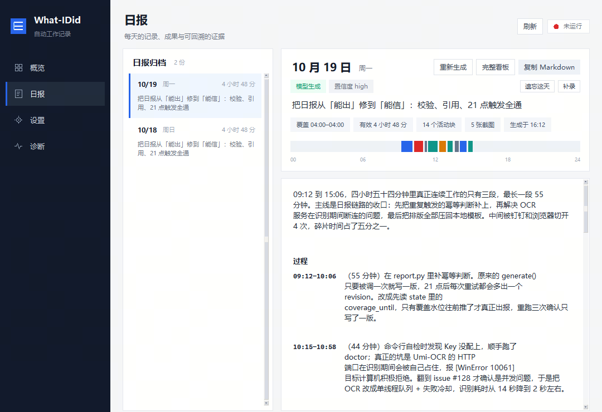

# What-IDid

[简体中文](README.zh-CN.md)

**Turns what you actually did today into a daily report you can read.**

What-IDid is a Windows desktop activity recorder. Roughly every 20 seconds it notes which window you are using and captures a screenshot when it matters, reads the text locally with OCR, slices the day into "activity blocks" and "behavior segments", and in the evening hands the result to an LLM that writes a chronological retrospective. Local templates then render it as Markdown and a static web dashboard.

It solves "at night I cannot remember what I did today". The difference is traceability: every claim in the report links back to the activity block and screenshot behind it, instead of being a smooth-sounding summary nobody can verify afterwards.



<sub>Daily report: dates on the left, report body, behavior timeline and evidence badges on the right (demo data).</sub>

## Features

- **Everything runs locally** — screenshots, OCR, segmentation and rendering all happen on your machine; **images never leave it**. Only redacted text summaries are sent to the model.
- **The format never drifts** — the model returns strict JSON only, and layout is decided entirely by local Jinja2 templates. No three-paragraph days and five-paragraph days.
- **Time is decided locally** — the start, end, duration and cut points of every segment are computed on your machine. The model can only answer "what was happening in this stretch", never change the time.
- **Claims stay traceable** — key progress and blockers must cite activity block IDs; claims without evidence are recorded as issues. A real ID does not prove causation, though.
- **Works offline** — with no API key, or with outbound calls disabled, it degrades to a plain-timeline report and retries the upgrade later when the network is back.
- **Forgettable** — delete by minute range or by whole day; deletion also cleans the shareable export and rewrites any weekly summary covering that day.
- **No extra dependencies** — copy one folder onto Windows 10/11 x64 and double-click. No Python, no administrator rights, no database, no web framework.

## How it works

```
Every 20±3s   read foreground window / idle / lock screen → privacy check → capture the active window only
              dHash + grid fingerprint dedupe → changed frames and periodic keyframes to disk
              crop at native resolution → local OCR (built-in engine, or a local Umi-OCR)

21:00         re-read history under the current privacy policy → activity blocks → behavior segments → reference resolution
              summary compression (hard character limit) → redact again at the boundary, check the outbound switch → model returns JSON
              validate block_id / ref_id / seg_id locally → render Markdown + static HTML

From 21:00    re-check every 20 minutes for 2 hours; skip when there is no new coverage
+3 min        catch-up run after login (machine was off last night, so yesterday's report is produced today)
Next 04:05    final version, folding in work done after 21:00
After 04:00   expire old screenshots, event streams and report OCR appendices
```

Report generation has three independent safety nets, and any one of them can produce the report: a standalone scheduled task (independent of the capture process), a watchdog inside the capture process, and a UI prompt plus the `report` command. "Should a report run now" is implemented in exactly one place, called by the scheduled task, the watchdog, the diagnostics page and the UI hint alike — so the UI never claims a report is due while the background disagrees.

Four key trade-offs:

| Trade-off | Why |
| --- | --- |
| The model decides *what* to say, not *how* it looks | It emits fixed-schema JSON; pages are rendered by local templates, so the format stays stable |
| Time is decided locally, the model only attaches labels | Once the model edits a timestamp, the whole timeline stops matching the screenshots |
| References are mandatory | Claims without `block_ids` go into `issues`; this only guarantees the IDs exist, not that the conclusion holds |
| Observed time ≠ working hours | Pauses and lock screen are already subtracted, but reading or watching a lecture still counts as low activity |

## Quick start

### Option 1: download and run (recommended)

1. Get `What-IDid-win64-*.zip` from [Releases](https://github.com/ShiyanXu/What-I-Did/releases) and unpack it into a **writable** location (for example `D:\Tools\What-IDid` or a USB stick; not `C:\Program Files`).
2. Double-click `What-IDid.exe` to open the UI; the first run creates `config.yaml` automatically.
3. Go to **Settings → API Key**, enter your model key, confirm the endpoint and model name, then save and click "Test connection" to verify.
4. Go to **Overview → Start capture**. To record automatically at boot, click **Settings → Start at login** (no administrator rights needed).

If you prefer the command line, `What-IDid.exe setup` runs the same wizard.

> The first launch may show "Windows protected your PC" because the executable is not code-signed. Click "More info" → "Run anyway". If a corporate antivirus flags it, whitelist the whole folder.

### Option 2: run from source

Requires Python 3.10+:

```bat
pip install Pillow numpy requests Jinja2 PyYAML psutil
python wid.py setup
python wid.py doctor
python wid.py start
```

For the built-in offline OCR, also install `rapidocr onnxruntime` (about 100 MB). Without it, What-IDid relies on a locally running Umi-OCR; with neither available, it degrades to recording window titles only.

### About closing the window

Clicking **×** only hides the UI into the system tray — **capture keeps running**. To really quit, right-click the tray icon → "Quit (stop capture)". This is deliberate: recording should not stop just because you closed a window on your way past.

## Interface

There is a single window with four pages:

| Page | Contents |
| --- | --- |
| **Overview** | Capture status, today's activity volume, free disk space; start / stop / pause / report now; today's behavior timeline; the last 14 days of activity (click a bar to jump to that day's report) |
| **Reports** | Dates on the left, report body on the right: opening, narrative, behavior timeline, manual entries, key progress, blockers and cost, insights, related documents; copy the Markdown, regenerate, open the full dashboard, add a manual entry, forget this day |
| **Settings** | Model endpoint and key, outbound switch, capture scope, sampling interval, OCR engine, report time and pre-send review, retention, privacy lists, start at login |
| **Diagnostics** | One-click self-check, live OCR test, cleanup preview, open logs and data directory |

The UI only "looks" and "manages": capture is handled by a separate background process, status refreshes every 3 seconds (15 seconds once minimised to the tray), every slow operation runs on a background thread, and buttons never freeze the window. Saving settings rewrites only the relevant line in `config.yaml`, preserving comments and formatting.

## Commands

One executable: no arguments opens the UI, a subcommand runs the CLI. Full arguments are in the [usage guide](docs/usage.md).

| Command | Purpose |
| --- | --- |
| `What-IDid.exe` | Open the graphical UI (same as double-clicking) |
| `What-IDid.exe doctor` | Environment self-check; `--full` also runs a live OCR test |
| `What-IDid.exe status` | Heartbeat, today's event and screenshot counts, disk, latest report |
| `What-IDid.exe start` / `stop` | Start / stop background capture |
| `What-IDid.exe pause --minutes 60` / `resume` | Temporarily pause / resume capture (meetings, screen sharing) |
| `What-IDid.exe report --date 2026-10-19` | Generate a given day's report on demand; `--force` re-runs it |
| `What-IDid.exe open` | Open the dashboard |
| `What-IDid.exe search 日报 校验 --days 30` | Cross-day search over titles, screen text and reports (local only) |
| `What-IDid.exe weekly --anchor 2026-10-19` | Generate the weekly summary (aggregates existing reports, no model call) |
| `What-IDid.exe export --date 2026-10-19` | Export a shareable report (no screenshots, no raw text, no local paths) |
| `What-IDid.exe forget --minutes 30` | Forget the last 30 minutes (irreversible) |
| `What-IDid.exe manual add --start 10:00 --end 11:00 --label "offline meeting"` | Record work the screen cannot see |
| `What-IDid.exe review show` / `approve` / `discard` | Inspect / approve / discard content awaiting review |
| `What-IDid.exe clean --dry-run` | Preview what would be deleted; drop `--dry-run` to actually delete |
| `What-IDid.exe autostart --status` / `--install` / `--remove` | Inspect / register / remove start at login |

## What a report looks like

Not a log of "apps I used today", but a retrospective in chronological order:

| Section | Answers |
| --- | --- |
| Title + opening | What kind of day this was, in one or two sentences |
| Narrative | In time order, each paragraph starting with a time: what you were doing, how far it got, what blocked it |
| Behavior timeline | `09:12–10:06 · 55 min · idempotency check for the report pipeline`, one line per segment, colored by behavior |
| Key progress | What got done + evidence (files, commands, error strings) + impact |
| Blockers and cost | Where it stuck, why, how long it took, how it was handled |
| Insights | Observation + evidence (citing local statistics) + what to do differently |

Behavior types come from a fixed vocabulary: coding, debugging, verifying, designing, researching, writing docs, meetings, communication, environment wrangling, chores, away. This is separate from app categories — inside the same editor, writing a feature and chasing an error are two different behaviors.

## Data and privacy

Data lives next to the program by default. If that location is not writable it falls back to `%LOCALAPPDATA%\What-IDid`, and the `WID_HOME` environment variable overrides both.

| Concern | What it does |
| --- | --- |
| Screenshots | Captures the active window only; skips the frame when the window is unavailable instead of falling back to the full screen |
| Sensitive apps | `blocked_apps` keeps an anonymous state only; `skip_ocr_apps` records app and duration but no title, no image, no OCR |
| Text | Titles and OCR text are redacted in four places — at rest, on re-read, in the summary, and at the HTTP boundary; built-in rules cover secrets, ID numbers, phone numbers and emails |
| Outbound | `privacy.allow_llm=false` blocks every model request; `report.review_mode=true` lets you read the payload and confirm before it is sent |
| Retention | Screenshots 7 days, event streams and OCR 30 days by default; report narratives are kept long term |
| Deletion | `forget` deletes a time range or a whole day; every report in the UI also has a "Forget this day" action |

**What it cannot promise**: regular expressions do not understand semantics and will not redact pixels inside a screenshot; copies already sent to a model provider, or saved elsewhere by you, cannot be recalled; observed time is not exact working time. See the [privacy notes](docs/privacy.md).

## Configuration

There is exactly one config file, `config.yaml` (created from `config.default.yaml` on first run). Model endpoint, sampling interval, privacy lists, retention and the report hour all live there. Any OpenAI-compatible endpoint works; the default is DeepSeek.

Common tweaks:

```yaml
llm:
  base_url: "https://api.deepseek.com/v1"   # any compatible endpoint: Qwen, Zhipu, SiliconFlow, local Ollama
  model: "deepseek-chat"

report:
  trigger_hour: 21          # re-register the scheduled task after changing the hour
  review_mode: false        # true = let you review before sending

privacy:
  capture_scope: active_window   # set to all_screens explicitly if you need the full screen
```

**A broken config is never silently reset to defaults**: the program stops content capture and outbound calls, explains why in the UI and in `doctor`, and waits for you to fix it. Per-key reference: [configuration](docs/configuration.md).

## Project layout

```
wid.py                  Single entry point: no arguments opens the UI, a subcommand runs the CLI
config.default.yaml     Configuration template
src/
  capture.py            Capture: foreground window, idle, lock screen → screenshot → dedupe → disk
  ocr.py                Local OCR: Umi-OCR first, built-in RapidOCR as fallback
  blocks.py             Event stream → activity blocks (stable block_id)
  behavior.py           Activity blocks → behavior segments (the model only fills verbs and labels)
  digest.py             Compress a whole day into the model input budget
  llm.py                OpenAI-compatible client (one POST, no SDK)
  validate.py           Validate block_id / ref_id / seg_id coming back from the model
  render.py             Render the Markdown archive and the static dashboard
  report.py             Report orchestration: load → segment → compress → model → validate → write
  tick.py               Scheduled-task entry point, decides which days are due
  privacy.py            Single privacy boundary: capture permission, anonymous events, redaction
  retention.py          Rolling cleanup of raw data
  forget.py             Forget by minute range or whole day
  manual.py             Manual entries and behavior relabeling
  search.py             Cross-day search
  weekly.py             Weekly summary
  export_safe.py        Shareable export
  gui.py / tray.py      UI and system tray (standard library + ctypes only)
  refs/                 Document reference resolution (local files, Obsidian, URLs, knowledge bases)
scripts/                Development, self-test and packaging scripts
docs/                   Documentation
```

## Documentation

| Document | Contents |
| --- | --- |
| [Architecture](docs/architecture.md) | Data flow, module responsibilities, data model, design trade-offs, extension points |
| [Usage guide](docs/usage.md) | UI, every command and argument, report mechanics, manual entries, review, forget, search, weekly summary, shareable export |
| [Configuration](docs/configuration.md) | Default value, purpose and failure behavior for every key |
| [Privacy](docs/privacy.md) | The four capture modes, the redaction chain, outbound control, retention and deletion |
| [Building and testing](docs/building.md) | Running from source, self-test scripts, packaging, common pitfalls |
| [FAQ](docs/faq.md) | Common questions and troubleshooting paths |

The detailed documents under `docs/` are currently written in Chinese.

## Known limitations

- **Observed time is not working time**: pauses and the lock screen are subtracted, but reading, watching lectures or attending meetings is still counted as low activity. "Longest focus" and "fragmentation ratio" are observation metrics, not productivity verdicts.
- **Causation cannot be proven**: mandatory back-references only guarantee that a cited activity block exists, not that the conclusion drawn from it is right.
- **Recognition is incomplete**: OCR quality depends on resolution and how readable the UI is; full-screen mode also includes secondary displays and background windows.
- **Windows only**: it depends on Win32 queries for window, idle and lock screen state. Targets Windows 10/11 x64; 32-bit and Windows 7 are not supported.
- **Mixed scaling is not thoroughly validated**: behavior with different per-monitor scaling factors has not been covered on real hardware. When coordinate spaces disagree the frame is skipped, so the worst case is a few missing records rather than misaligned images.

## Contributing

- Code, self-tests, pull requests: see [contributing](CONTRIBUTING.md)
- Privacy or security defects: report privately per the [security policy](SECURITY.md) — **do not** open a public issue
- Usage questions: check the [FAQ](docs/faq.md) first, and open an issue if that does not help

## License

[MIT](LICENSE)
